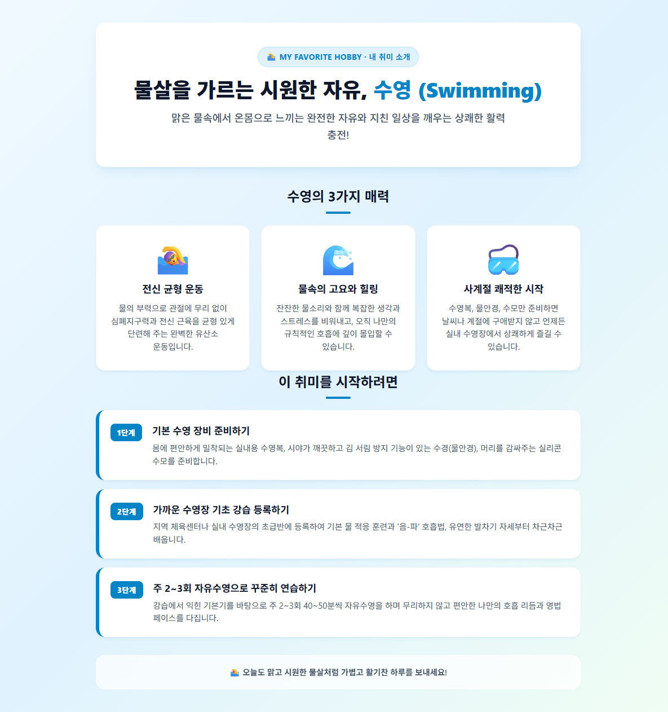
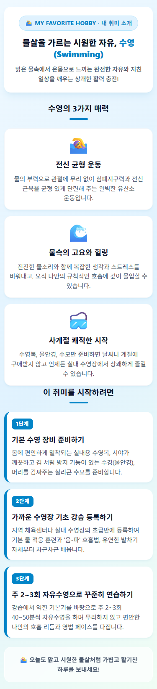

# 🏊 [실습1] 내 취미 소개 홈페이지: 수영 (Swimming / 我的爱好：游泳)

내 취미인 **수영(Swimming)**을 소개하는 반응형 정적 웹페이지입니다.  
설치나 외부 서버 없이 `index.html` 파일을 더블 클릭하여 브라우저에서 바로 열 수 있습니다.

---

## 📌 주요 특징 및 구현 기능

1. **취미 한 줄 소개 및 제목**
   - **제목**: 물살을 가르는 시원한 자유, 수영 (Swimming)
   - **한 줄 소개**: 맑은 물속에서 온몸으로 느끼는 완전한 자유와 지친 일상을 깨우는 상쾌한 활력 충전!
2. **사진 대신 이모지 카드 3장**
   - 🏊‍♀️ **전신 균형 운동**: 부력을 활용해 관절 부담 없이 전신 근력과 지구력을 기르는 완벽한 유산소 운동
   - 🌊 **물속의 고요와 힐링**: 잔잔한 물소리와 함께 스트레스를 비우고 나만의 호흡에 깊이 몰입
   - 🥽 **사계절 쾌적한 시작**: 수영복, 물안경, 수모만 준비하면 사계절 내내 실내에서 즐길 수 있는 운동
3. **"이 취미를 시작하려면" 3단계 안내**
   - **1단계**: 기본 수영 장비 준비하기 (실내 수영복, 안티포그 수경, 실리콘 수모)
   - **2단계**: 가까운 수영장 기초 강습 등록하기 (초급반 등록 및 물 적응, 호흡법, 발차기 습득)
   - **3단계**: 주 2~3회 자유수영으로 꾸준히 연습하기 (나만의 페이스와 안정적인 호흡 리듬 완성)
4. **완벽한 모바일 반응형 웹 디자인**
   - Flexbox 및 CSS Grid 레이아웃, `word-break: keep-all`, `overflow-wrap: break-word`를 적용하여 PC뿐만 아니라 좁은 모바일 화면(375px)에서도 텍스트 잘림이나 가로 스크롤 없이 자연스럽게 자동 줄바꿈됩니다.
5. **무설치 / 순수 정적 웹 (Pure Static Web)**
   - 외부 서버, 패키지 설치, 외부 폰트/CDN 없이 순수 HTML5와 CSS3만으로 구동됩니다.

---

## 📁 파일 구조

```
├── index.html              # 시맨틱 마크업 기반 정적 웹페이지
├── style.css               # 모던 오션 블루 테마 및 모바일 반응형 스타일시트
├── screenshot_pc.png       # PC 폭(1200px) 검증 스크린샷
├── screenshot_mobile.png   # 모바일 폭(375px) 검증 스크린샷
└── README.md               # 프로젝트 안내 문서
```

---

## 🖥️ 실행 및 검증 화면

### 1. PC 화면 (1200px 폭)


### 2. 모바일 화면 (375px 폭)

